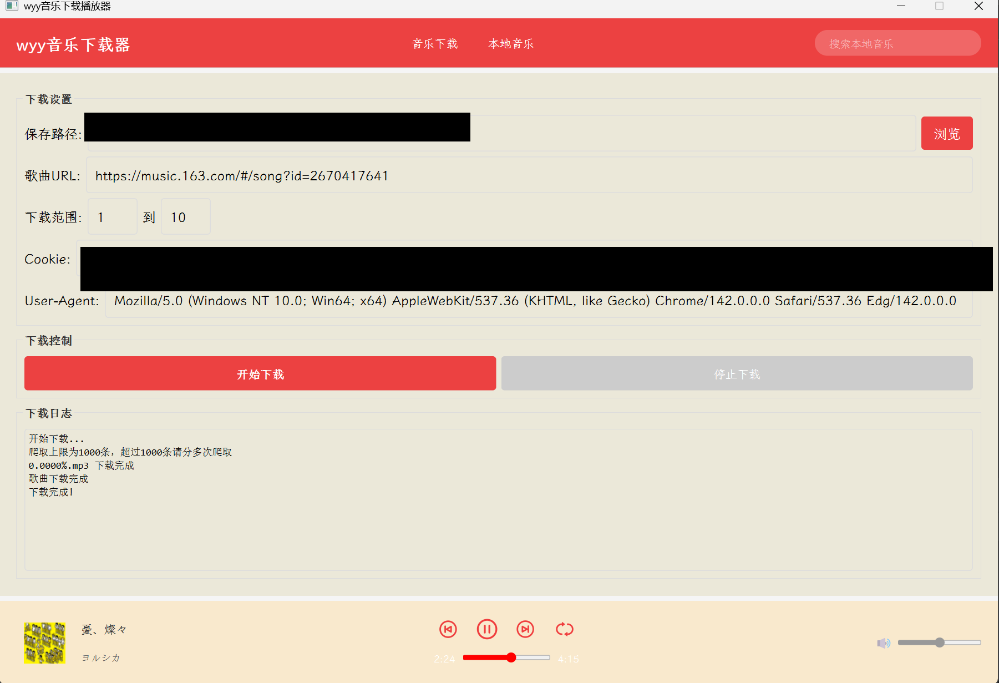
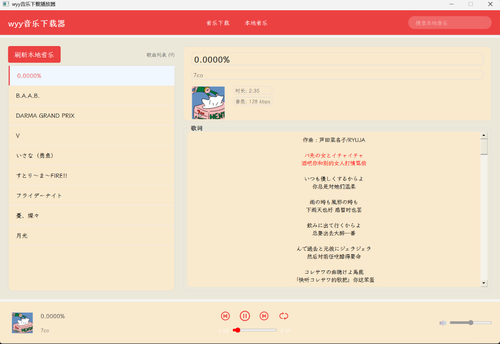
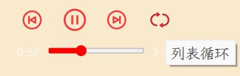
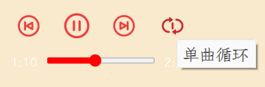

# WYY-PYQT


## 第一章 绪论

### 第一节 为什么做这个

纯吃着空。

### 第二节 实验环境

- **编程工具**：Python 3.13
- **主要的库**：PyQt6、requests、selenium、playwright、asyncio、mutagen 等
- **操作系统**：Windows 11、Edge 142（可以随着自己的更改）

---

## 第二章 系统总体设计方案

### 第一节 系统总体功能

整个程序结构如下：

```text
项目根目录/
├── function/
│   ├── images/
│   ├── fonts/
│   ├── sercet.py
│   ├── wyy_main_func_window.py
│   ├── wyybk.py
│   ├── wyydownload_async.py
│   ├── wyylyrcis.py
│   ├── wyysinglemusic.py
│   ├── wyysonger.py
│   └── wyysonglist.py
├── txt/
├── img/
├── music/
├── song.txt
├── setting.json
├── msedgedriver.exe
└── main.py              # 主程序文件
```

#### （1）爬虫部分

WYY主要的功能是由 AES 构成的。在 F12 开发者工具下，在源代码中寻找以下文件：

```text
https://s3.music.126.net/web/s/core_63ade85b6116b4c5478bd99cd397debe.js?63ade85b6116b4c5478bd99cd397debe
```

可以在其中发现 `window.asrsea = d`。这句话在文件中前后基本上传递了网易云音乐的音乐信息，例如 `'010001'`、`'0CoJUm6Qyw8W8jud'`，还有 `{{"ids":"[{num}]","level":"exhigh","encodeType":"aac","csrf_token":"{csrf_token}"}}`，其中 `num` 是歌曲的 id 值，`csrf_token` 是网易云特有的 token 值，而且它一直不变，始终是 `d5173e02fd2de201b463865127ea7ad1`，所以我们可以写出它的底层逻辑。在 `sercet.py` 中：

```python
import math
from Crypto.Cipher import AES
import base64
import codecs
import random

def detect_name(text):
    special_chars = '\\/?"*:<>|'  # 注意：反斜杠需要转义
    for char in special_chars:
        if char in text:
            text = text.replace(char, '')
    return text

class Secret_AES:
    def __init__(self):
        self.e = '010001'
        self.f = "00e0b509f6259df8642dbc35662901477df22677ec152b5ff68ace615bb7b725152b3ab17a876aea8a5a" \
                 "a76d2e417629ec4ee341f56135fccf695280104e0312ecbda92557c93870114af6c9d05c4f7f0c3685b7a46be" \
                 "e255932575cce10b424d813cfe4875d3e82047b97ddef52741d546b8e289dc6935b3ece0462db0a22b8e7"
        self.g = '0CoJUm6Qyw8W8jud'
        self.random_text = self.get_random_str()

    def get_random_str(self):
        str = 'abcdefghijklmnopqrstuvwxyzABCDEFGHIJKLMNOPQRSTUVWXYZ0123456789'
        res = ''
        for x in range(16):
            index = math.floor(random.random() * len(str))
            res += str[index]
        return res

    def aes_encrypt(self, text, key):
        iv = '0102030405060708'.encode('utf-8')  # IV 转为 bytes
        key = key.encode('utf-8')                # 密钥转为 bytes
        pad = 16 - len(text.encode()) % 16
        text = text + pad * chr(pad)
        encryptor = AES.new(key, AES.MODE_CBC, iv)
        ciphertext = encryptor.encrypt(text.encode('utf-8'))  # 明文转为 bytes
        return base64.b64encode(ciphertext)

    def rsa_encrypt(self, value, text, modulus):
        '''进行rsa加密'''
        text = text[::-1]
        rs = int(codecs.encode(text.encode('utf-8'), 'hex_codec'), 16) ** int(value, 16) % int(modulus, 16)
        return format(rs, 'x').zfill(256)

    def get_data(self,text):
        params = self.aes_encrypt(text, self.g)
        params = self.aes_encrypt(params.decode('utf-8'), self.random_text)
        enc_sec_key = self.rsa_encrypt(self.e, self.random_text, self.f)
        return {
            'params': params.decode('utf-8'),
            'encSecKey': enc_sec_key
        }
```

有了它的底层逻辑之后，爬虫功能也就简单了，可以通过 requests、selenium、playwright 等对网易云音乐进行爬取。这里对单曲和异步多曲进行说明，其他的播客、歌单等都是在此基础上编写的。

**单曲下载**

对于单曲的爬取，这里使用 selenium 进行爬取。因为使用的是 Edge 142 版本，所以使用了 msedgedriver 142 版本。使用无头模式、禁用 GPU、无视证书、启用用户模式等，保证爬取的成功性；再通过 BeautifulSoup 美化页面，用正则获取歌曲的信息。通过之前的 AES 逻辑，获取 MP3 歌曲。这里先将歌曲变成 m4a 文件，以保证更准确地生成 MP3 文件，之后通过 mutagen 将取出来的封面、作者加入歌曲中。在 `WYYLYCIS` 中，可以通过网易云的 API，例如 `http://music.163.com/api/song/lyric?id=1363686359&lv=1&kv=1&tv=-1` 获取歌词翻译数据。

#### （2）PyQt6 窗口

在 `MusicPlayer` 中，进行三部分的设计：下载界面、播放界面和操纵界面。其中的 cookie 和 user-agent 等数据较长，这里用 json 文件保存信息，再通过 function 中的代码获取歌曲下载。在操纵总列表下，有暂停、上下曲、播放模式转换、音量调整等；在播放列表下，可以获取歌曲、歌词展示、封面作者信息等。


- **资源解析**：用户输入网易云音乐 URL 后，系统根据 URL 中的特征字段（如 `song?id=`、`playlist?id=` 等）判断资源类型，调用对应的解析类（如 `WYYMusic_singlemusic` 类用于单曲解析、`WYYsonglist` 类用于歌单解析）解析网页源码，提取歌曲 ID、名称、歌手、专辑封面 URL 等关键信息。
- **请求加密**：根据提取的歌曲 ID，构建音乐下载请求参数，通过 `Secret_AES` 类对参数进行 AES 双重加密和 RSA 加密，生成符合平台接口要求的 `params` 和 `encSecKey` 参数。
- **数据下载**：使用加密后的参数发送 POST 请求到网易云音乐接口，获取音乐文件的真实下载链接，通过 GET 请求下载音乐数据（M4A 格式）；同时下载专辑封面图片和歌词数据。
- **文件处理**：将下载的 M4A 格式音乐文件转换为 MP3 格式，通过 mutagen 库添加歌曲元数据（歌手、标题、专辑封面等），并删除临时的 M4A 文件；将歌词数据保存为 LRC 格式文件，存储到指定目录。

歌词处理模块的核心实现逻辑分为歌词获取、歌词解析、同步显示三个步骤：

- **歌词获取**：下载歌曲时，系统根据歌曲 ID 调用网易云音乐歌词接口，获取对应的歌词数据（包括原文和译文），并保存为 LRC 格式文件到 `txt` 目录下。
- **歌词解析**：播放歌曲时，系统读取对应的 LRC 文件，使用正则表达式提取时间戳（转换为毫秒级）和歌词文本，生成结构化的歌词数据列表（包含时间戳和对应歌词），并按时间戳排序。
- **同步显示**：播放过程中，系统实时获取当前音乐播放进度（毫秒级），遍历歌词数据列表找到匹配的歌词索引，通过高亮显示当前歌词、平滑滚动歌词面板等方式，实现歌词与音乐的精准同步。

### 效果展示



*图 1　音乐下载界面*



*图 2　本地音乐播放界面与歌词同步*

播放模式切换效果：

| 列表循环 | 单曲循环 | 随机播放 |
| :---: | :---: | :---: |
|  |  |  |

### 注意

- setting.json文件中的cookie、user-agent修改成自己的，这个是过期的，无法使用。如果在wyy上没有会员，也无法爬完整的歌。切记哦。

### 作者与维护者

- 作者：`weilipan`
- 邮箱：`weili31415@foxmail.com`